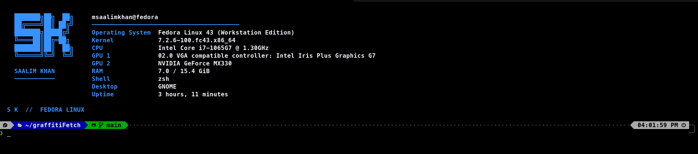

# graffitiFetch 

> A custom, lightweight, and vibrant terminal system information fetch utility built specifically for Fedora Linux and Zsh environments.

---

## preview



---

## Features

- **Fedora & Zsh Optimized:** Tailored specifically to showcase Fedora versioning, kernel details, and hardware specs inside a Zsh terminal.
- **Vibrant ASCII Art & Layout:** Cleanly structured columnar view featuring CPU, RAM, GPU, OS, Uptime, and Shell information.
- **Powerlevel10k & Oh My Zsh Friendly:** Includes built-in configuration guides to prevent output suppression warnings and prompt jumping.
- **Single-Execution Safeguard:** Designed to run seamlessly on terminal startup without redundant printing when opening subshells or tabs.

---

## Prerequisites

- **Shell:** `zsh` (version 5.8 or higher recommended)
- **OS:** Fedora Linux (Workstation Edition or similar)
- **Prompt Theme (Optional):** [Powerlevel10k](https://github.com/romkatv/powerlevel10k) & [Oh My Zsh](https://ohmyz.sh/)

---

## Installation Guide

### 1. Clone the Repository
Clone your repository locally using Git:
```bash
git clone https://github.com/Saalim398/graffitiFetch.git ~/graffitiFetch
cd ~/graffitiFetch
```

### 2. Install to Local Binaries
Copy the script to your local user binary directory and make it executable:
```bash
mkdir -p ~/.local/bin
cp graffiti-fetch ~/.local/bin/
chmod +x ~/.local/bin/graffiti-fetch
```

### 3. Verify PATH Configuration
Ensure your local binary path is included in your shell's `PATH`. You can check or add this to your `~/.zshrc`:
```bash
export PATH="$HOME/.local/bin:$PATH"
```

---

## Shell Integration (`~/.zshrc`)

To ensure smooth startup performance, clean command functionality (`ls`, `git`), and prevent output suppression warnings when using Powerlevel10k, add the following optimized configuration block to your `~/.zshrc`:

```zsh
# ==========================================
# Powerlevel10k Instant Prompt Configuration
# ==========================================
# Set to 'off' or 'quiet' to allow startup fetch script execution without warnings
typeset -g POWERLEVEL9K_INSTANT_PROMPT=off

# ==========================================
# Environment & PATH Setup
# ==========================================
export PATH="$HOME/.local/bin:/usr/bin:/usr/sbin:/bin:/sbin:$PATH"
export ZSH="$HOME/.oh-my-zsh"

# ==========================================
# Oh My Zsh Framework & Plugins
# ==========================================
ZSH_THEME="" # Disabled to let Powerlevel10k handle prompt rendering
HIST_STAMPS="mm/dd/yyyy"
plugins=(git)

[[ -f $ZSH/oh-my-zsh.sh ]] && source $ZSH/oh-my-zsh.sh

# ==========================================
# Theme & Prompt Loading
# ==========================================
[[ -f ~/powerlevel10k/powerlevel10k.zsh-theme ]] && source ~/powerlevel10k/powerlevel10k.zsh-theme
[[ -f ~/.p10k.zsh ]] && source ~/.p10k.zsh

# ==========================================
# Useful Shell Options & History Settings
# ==========================================
HISTSIZE=10000
SAVEHIST=10000
setopt SHARE_HISTORY          # Share command history across tabs
setopt HIST_IGNORE_DUPS       # Ignore duplicate history entries
setopt HIST_IGNORE_SPACE      # Ignore commands starting with a space

# ==========================================
# Helpful Aliases & Colors
# ==========================================
alias ls='ls --color=auto'
alias ll='ls -la'
alias la='ls -A'
alias grep='grep --color=auto'

eval "$(dircolors -b 2>/dev/null)" || true

# ==========================================
# Automatic graffitiFetch Execution on Startup
# ==========================================
if [[ -o interactive && -t 1 && -z "$GRAFFITI_FETCH_RUN" ]]; then
  export GRAFFITI_FETCH_RUN=1
  if [[ -x "$HOME/.local/bin/graffiti-fetch" ]]; then
    $HOME/.local/bin/graffiti-fetch
  elif [[ -x "$HOME/.local/bin/sk-fetch" ]]; then
    $HOME/.local/bin/sk-fetch
  fi
fi
```

---

## Manual Usage

You can run the script manually in your terminal at any time:

```bash
graffiti-fetch
```

---

## Contributing

Contributions, issues, and feature requests are welcome! Feel free to check the [issues page](https://github.com/Saalim398/graffitiFetch/issues).

1. Fork the Project
2. Create your Feature Branch (`git checkout -b feature/AmazingFeature`)
3. Commit your Changes (`git commit -m 'Add some AmazingFeature'`)
4. Push to the Branch (`git origin push feature/AmazingFeature`)
5. Open a Pull Request

---

## License

Distributed under the MIT License. See `LICENSE` for more information.
